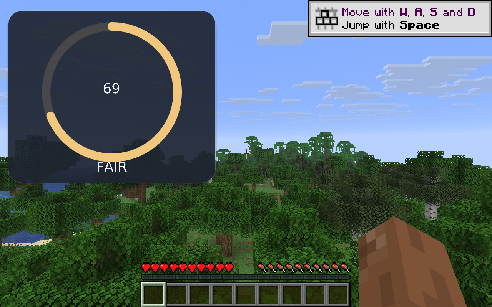
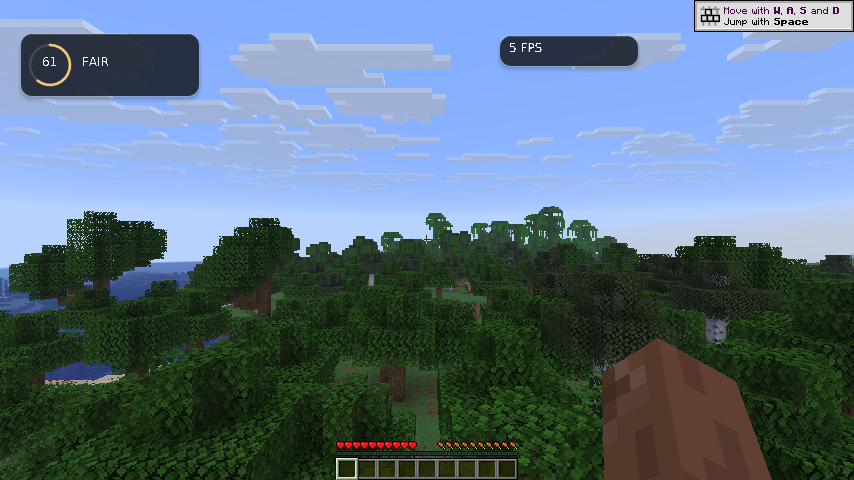
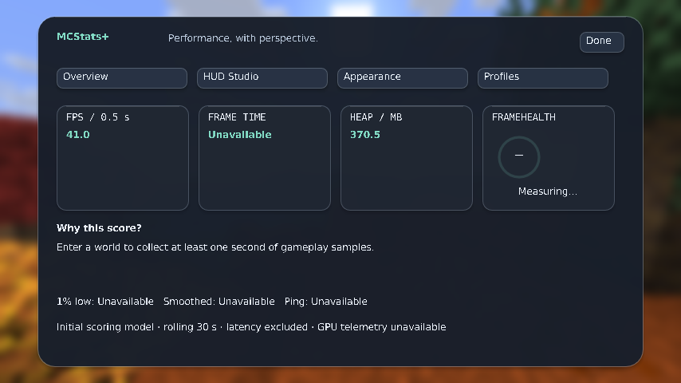

# Rendering and frame-sampling correction

## Audit

The previous code did not contain a 60 Hz timer or clamp. Its HUD used `Minecraft.getFps()`, while the dashboard's generically labelled FPS card displayed a 30-second average. These were different statistics with different response times. The old frame-history hook was `runTick` HEAD, which was not an authoritative record of all completed `renderFrame` calls. The original reported 230-versus-60 discrepancy has not been reproduced on this machine.

The corrected hook runs immediately after Minecraft increments its `frames` field in `renderFrame`, before the same method publishes F3's FPS counter. Early returns which do not complete a frame do not enter the sample stream. Both the FrameHealth ring and the short FPS window consume these monotonic timestamps. The half-second window has allocation-free ingestion/publication, is not clamped to a monitor refresh rate, and can be published at 4 Hz independently of frame sampling. Session, 30-second average, smoothed reciprocal duration and worst-1%-duration statistics remain distinct. The dashboard now explicitly labels its headline **FPS / 0.5 s**.

The former corners were horizontal strips whose alpha coverage was computed at integer **GUI** coordinates. At GUI scale 3, each edge-coverage unit became roughly three physical pixels. Increasing the number of strips would not fix that error. The former gauge was sixty separate rounded dots; its label was placed to the side, and old 40-pixel-high gauge profiles could clip the layout.

Fonts already used TrueType assets, not Minecraft's bitmap font for ordinary Latin text. However, glyph rasterization used only 2x oversampling while the layout could undergo multiple scales; glyph origins were not aligned after those transforms. The fourth style was an unrelated serif family. No custom framebuffer existed and no framebuffer has been added by this correction.

## Replacement pipeline

- Panels and arcs use the existing Minecraft 26.3 `RenderPipelines.GUI` color pipeline and native GUI batching. There are no custom shader programs, textures, render targets or framebuffer allocations per frame.
- Curved interiors are tessellated to a subpixel chord-error target. A separate vertex-alpha fringe spans **one framebuffer pixel**, computed from the window/GUI ratio and current affine scale. More tessellation alone is not the antialiasing mechanism. Inner and outer ring edges receive coverage; partial arcs have rounded caps. Coverage uses Minecraft's native straight-alpha blend convention.
- Render states copy the current transform and carry transformed bounds and the current MCStats clip intersection. HUD/graph clipping still also calls Minecraft's scissor stack. Uniform GUI/widget scales are the supported transforms used by this UI.
- Panel border inset is one physical pixel, with layered low-opacity shadow geometry and a thin highlight. Native screen blur is no longer implicitly inherited: the optional blur is requested before our geometry and text are extracted. It never blurs the completed UI surface.
- Native FreeType/TrueType atlases rasterize individual glyphs at 8x oversampling and cache them. This is glyph rasterization, not supersampling an entire interface. Text origins are aligned to the final physical pixel grid while preserving native advance/baseline metrics and fractional layout. Widget spring transforms retain floating-point coordinates, rather than snapping geometry motion to whole GUI pixels. Missing glyphs retain Minecraft's fallback.
- Styles are related DejaVu Sans regular/bold/condensed, plus Sans Mono. The legacy `serif` resource identifier is preserved for old profiles, but now selects condensed sans. The regular font's ten digit advance widths were inspected: each is **1303 font units**, so centered scores use genuine tabular advances.
- Compact health cards have a small continuous ring and centered score; detailed gauges have a larger ring, centered score and classification beneath. Minimal pills retain their small indicator. Legacy detailed-gauge dimensions are migrated to a readable minimum. Resizing preserves that minimum.
- Arc and number use the same animated score in the same draw. Classification applies the shared hysteresis rule to that displayed score. Color channels interpolate and clamp safely. Measurement and visual interpolation remain separate.

## Verification

`build` executes **20 passing regression cases**, including synthetic completed-frame streams at 60, 120, 230 and 1000 FPS; independent 4 Hz publication; a 230-to-60 rate change; mesh winding and transparent coverage for zero/quarter/half/full arcs; gauge-profile migration; scoring; hysteresis; interpolation; and persistence. This proves the rate arithmetic is not restricted to 60. It does not constitute a 230 FPS hardware test.

The Minecraft client ran under Xvfb and Mesa lavapipe Vulkan. Real gameplay captures were inspected at actual GUI scales **1, 2 and 3**, including a compact card, a detailed gauge, changing scores/categories, rounded caps, and the measured FPS pill. Increasing the window size allowed actual GUI scale 3 rather than merely requesting a scale that the small window could not support.





A representative stable native window logged:

```
Completed-frame window=8 FPS; Minecraft F3 reference=8 FPS
HUD half-second FPS=7.740307782038103
sampler: 49427 ns/call, 357 bytes/call
HUD extraction: 185585 ns/call, 7037 bytes/call
geometry build: 3121 ns/call, 0 bytes/call
```

Different native five-second gameplay observation windows yielded approximately 7–9 FPS and reference counters in the same range; short and long windows differ during load/transitions. These are actual measurements, not substituted 60/120 FPS values. Across sampled steady windows, single-gauge geometry building took roughly 4–6 microseconds per shape with zero measured Java allocations in `buildVertices`; extraction was around 0.10–0.13 ms for the single detailed gauge. The two-widget compact-card/FPS layout had roughly 6–7 KiB of extraction allocations per frame. These figures include opt-in instrumentation and are not a total GPU-overhead benchmark.

For reproduction, add `-Dmcstats.verify=true` to the development client's JVM arguments. Diagnostics log actual completed-frame rate, Minecraft's reference counter, the HUD's short rate, and timing/allocation for sampling, HUD/dashboard extraction and geometry construction. Diagnostics are disabled by default. Counter windows should be compared after warmup in a stable scene.

Additional menu checks reached a native 60 FPS: a five-second completed-frame window of 60 and F3 reference of 60 corresponded to a HUD short-window measurement of **59.992 FPS**. Both counters also followed Minecraft’s idle throttle to **30 FPS**, with the HUD measuring **29.998 FPS**. These are menu/idle checks, not 60 FPS gameplay results.

A HUD-disabled gameplay baseline remained around 8 FPS, with roughly 7 microseconds and zero Java allocations per sampler call. It did not establish an end-to-end overhead percentage. In a separate dashboard comparison with input kept active to avoid idle throttling, blur off measured **60 FPS**, about **0.080 ms** extraction time and **38 KiB** extraction allocations per frame; blur on measured **39–41 FPS**, about **0.101 ms** extraction time and similar allocations. These figures show a substantial optional blur cost on this software renderer. Blur remains disabled by default. Extraction allocation includes native text/render-state construction; glyph-atlas caching does not make the entire UI allocation-free.



## Validation limits

This software renderer remained below 60 FPS in the test world; no hardware graphics device was available. VSync on/off and requested 30/60/uncapped limits were exercised, but the native **60, 120 and 200+ FPS gameplay target matrix could not be reached**; high-rate arithmetic was tested with synthetic timestamps instead. Real high-DPI display behavior, Sodium/Iris, and end-to-end GPU overhead remain unverified. The actual 230-versus-60 report therefore requires a high-FPS hardware confirmation before being described as fully resolved. No <1% total-overhead or comparative visual/performance-improvement percentage is claimed.

The final compiled client was also relaunched in the local world after the floating-point transform and presentation-state changes. Its completed-frame window, short-window FPS and Minecraft reference continued to agree in the same low-FPS range, and the gauge continued rendering and updating. This is a runtime smoke check, not a substitute for the remaining high-FPS hardware matrix.
