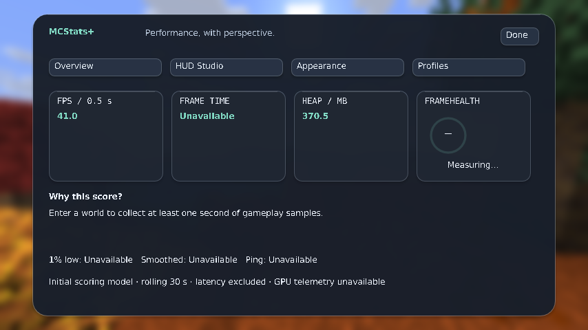
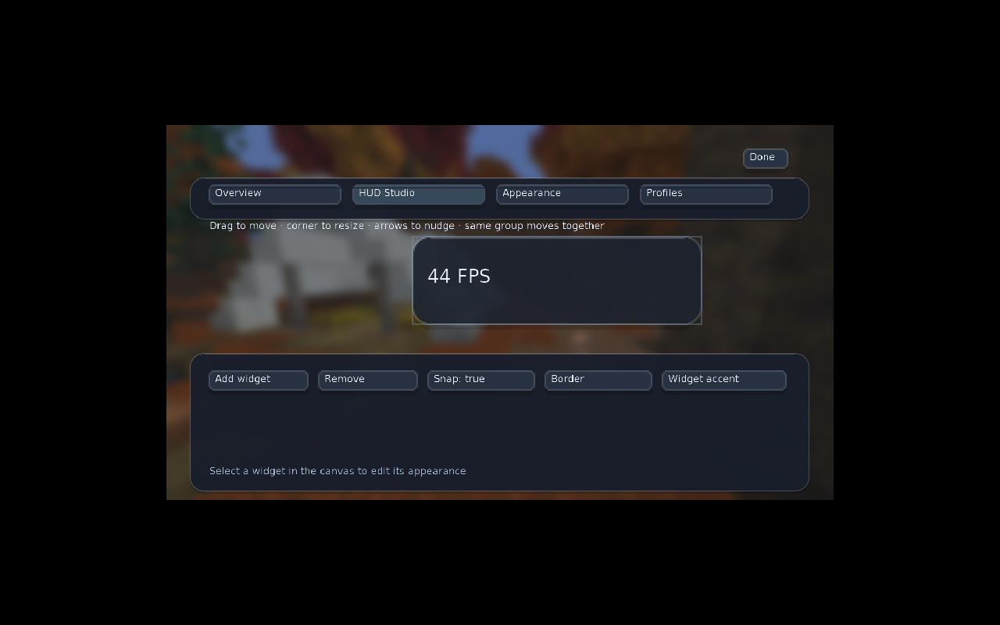

# Validation

Tested with the repository's original Minecraft 26.3, Fabric Loader 0.20.1, Fabric API 0.166.2+26.3, Java 25 and Gradle 9.8.2 pins.

| Check | Outcome |
| --- | --- |
| `build` | Passed, including the installable client jar |
| `coreTest` via `check` | 15 named regression cases executed and passed |
| `coreBenchmark` | 4.6 ns/ring write; 1.079 ms/scoring evaluation of 65,536 frames in the final benchmark run |
| Client launch | Passed using Xvfb and Mesa lavapipe software Vulkan |
| Singleplayer gameplay | Entered a local world; FrameHealth pill rendered live measured scores and changing categories |
| Dashboard | Opened through title-screen MCStats+ button; native fonts, cards and navigation rendered |
| FPS-only preset | Applied through Profiles; confirmed one FPS widget in current profile and saved slot |
| Clipboard | Exported and imported a profile through the UI; import confirmation displayed |
| HUD Studio | Selected, dragged and resized a widget through native mouse events; coordinates and dimensions persisted |
| Keyboard interaction | Named SDL constants verified against 26.3; automated keyboard smoke test unavailable because XTest keys, including vanilla Escape, were not reaching the SDL client reliably |
| Sodium/Iris | Not tested |
| Total FPS overhead | Not measured; core microbenchmark is not evidence for the <1% gameplay goal |

The first OpenGL launch failed to find a matching GLX visual. Selecting the installed software Vulkan driver resolved client startup. The machine has no sound device and no authenticated Minecraft Services session, so startup logged audio and online-service warnings. Offline singleplayer and mod rendering still worked. No TLS, package-signature, or artifact-checksum verification was disabled.

The benchmark is a JVM microbenchmark, not JMH or a hardware-independent guarantee. It excludes GUI submission, font rasterization, driver behavior and Minecraft gameplay. FrameHealth remains an initial scoring model requiring calibration; see the formulas and limitations in the main README.

Advanced widget-to-dashboard morphing, widget-to-widget snapping, gameplay blur and native GPU telemetry remain follow-up work. The shipped fallback renders translucent glass without replacing Minecraft's rendering pipeline. Vanilla screen background effects remain subject to Minecraft's own menu settings.

## Captures from the final client

The dashboard below is opened from the title screen, so gameplay-only statistics correctly remain unavailable while real JVM heap telemetry is shown. The studio capture shows the saved FPS widget using the live menu frame counter. These are native Minecraft screenshots, not browser mockups.

The corrective rendering/FPS work has newer results in [RENDERING-QUALITY.md](RENDERING-QUALITY.md). Its build executes 20 cases; the earlier results above describe the initial implementation, not the current renderer.
